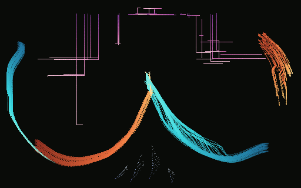

# Nocturne in Countercurrent

**Original FIELDWEAVER composition, 11 November 2026.** A study in bilateral circulation: a warm, sediment-bearing flow enters from the upper left; two cool filament ribbons enter from opposite edges; sparse suspended dust descends over them; vertical violet shards cut across the lower register. Two opposite-sign vortices, a central attractor and a temporary sixteen-direction quantizer create a score that changes from curved trajectories to crystalline interruptions and back.

This artwork has a **checked-in, visually inspected canonical PNG** generated by FIELDWEAVER's real FW-012 software-raster path on a GitHub-hosted Node 24 runner. The inspected image is sparse: separate teal, amber and cyan sweeps, angular violet shard tracery and a large uninterrupted dark field. No ImageGen stand-in, WebGL framebuffer, fabricated contact sheet or third-party source image was used.



## Work identity and delivery

| Property | Value |
|---|---|
| Source | Native procedural FIELDWEAVER materials/fields/emitters; no external bitmap |
| Recipe | [`recipe.json`](./recipe.json) |
| Recipe/schema | `fw-recipe-v1` / `fw-agents-v1` |
| Root seed | `0x77d5e2a1` (2010505889) |
| Runtime-verified recipe hash | `ee1696765f96ef0c` |
| Canonical raw RGBA8 hash | `1427da2094a6b26a` |
| Canonical depositions | **41,463** |
| Native output | [`nocturne-in-countercurrent.png`](./nocturne-in-countercurrent.png) and [provenance](./nocturne-in-countercurrent.provenance.json) |
| Fields | Six: uniform, two counterrotating vortices, central attractor, turbulence, gated direction quantization |
| Materials/emitters | Ink, filament, dust, shard; six deterministic emitters with different geometries and schedules |
| LUT logic | Five authored assets, four material-specific RGBA ramps, dust steering and filament deposition-strength mappings |
| Timeline | Thirteen explicit ordered commands, including releases, rate change, material change, toggles and a four-tick freeze |
| Target tick | **156** |
| Framing | **512 × 320** RGBA8, centre (160,128), **0.625 world units/pixel** (`40960` Q16.16) |
| Renderer | FW-012 canonical CPU/software raster and provenance |

The observed image is asymmetric rather than a symmetric infinity loop. Offset flow sources produce a left cyan hook, a lower warm sweep, an elevated central teal ribbon and an isolated amber crest at the upper right. Sparse rectilinear magenta shard trails interrupt otherwise smooth marks. The broad dark background remains deliberate negative space. Aesthetic admission and distinctiveness against other commissioned work remain the Integration worker's responsibility.

## Temporal structure

| Tick | Intervention | Intended formal effect |
|---|---|---|
| 0–27 | Opposed filament entrances; ink and dust begin; bursts at 24/27 | Separate directional families establish the horizontal weave |
| 38–58 | First ink emitter stops; dust burst at 48; shard steering changes at 58 | A denser central deposit and sharper lower-register cuts |
| 72–83 | Enable 16-sector quantization; freeze at 79, resume at 83 | Angular interval and retained rest before motion resumes |
| 94–118 | Disable the right vortex; accelerate shard emission; remove quantizer | A temporary opening in the right-hand circulation |
| 122–156 | Late ink burst; restore right vortex at 131 | A final rejoining of asymmetrical currents |

## Reproduce and verify

On Node.js 22 or 24, from repository root:

```sh
npm ci
npm run verify
node gallery/originals/01-nocturne-in-countercurrent/qualify.mjs --write
```

The qualification script imports the **actual repository renderer and recipe replay**, not a replacement implementation. It validates normalized recipe round-trip and expected recipe hash, runs to tick 156, independently exports with two awkward tile shapes, compares state/deposition/result/raw-RGBA identities, decodes the output PNG and verifies exact pixel equality. It also asserts the checked-in PNG bytes and provenance JSON are **identical** to the freshly generated canonical result. The `composition.test.mjs` file is discoverable by the repository's `node --test` command. Without `--write`, qualification performs validation only.

Successful `--write` produces:

- `rendered/nocturne-in-countercurrent.png` — genuine canonical PNG;
- `rendered/nocturne-in-countercurrent.provenance.json` — FW-012 export sidecar with actual canonical hashes;
- `rendered/qualification.json` — concise evidence receipt.

The root of this artwork directory already includes the **checked-in canonical PNG**, its FW-012 full [provenance](./nocturne-in-countercurrent.provenance.json), and a [qualification receipt](./qualification.json). They were archived from the original renderer output on the exact-source [Node 24 CI job](https://github.com/techrote/FIELDWEAVER/actions/runs/42931225797) (source commit `96c87df1377a3aaeada32e66efc1f6ee59267742`). The original artwork producer cannot clone Github to a local Node process here, so validation was performed on the project's own Ubuntu CI Node runtime. The test now independently re-renders and byte-compares the committed artifacts on every Node 22/24 CI run; local `--write` also emits working copies to `rendered/`.

**Acceptance:** Keep the PR Draft for Integration's exact-head tests and independent aesthetic/differentiation review; output provenance and canonical pixel reproducibility are machine-checkable, whereas curatorial acceptance is not.

Ownership: all proposed files remain under this artwork's own directory. No shared engine, UI, catalog, preset, test-suite infrastructure or historical artwork is modified.
