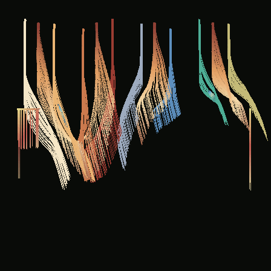

# The Luminous Ledger

**FIELDWEAVER original composition 02** · *An instrument of rain, interruptions, and ruled light.*

*Canonical CPU output at tick 168; not a WebGL screenshot or illustrative proxy.*

This is a deliberately architectural score rather than a pair of whirling currents. Eight closely registered filament sources descend from near the top margin as coded staves. Four broader ink sources mark the spaces between them; two offset dust sources cut oblique cross-talk through the middle register; a pair of late shard emitters score horizontal disruptions. The discrete vertical array is intended to hold even when its organising rule briefly fails.

A four-sector quantizer initially constrains the long downward motion. The layer stack contains global gravity, two initially dormant signed attractors, low-amplitude seeded turbulence, the quantizer, and a dormant horizontal pressure field. These are not after-the-fact pixel effects: material movement and deposition are produced by deterministic fixed-step simulation. Pigment LUTs separate ivory, ochre, iron-red, sea-glass and cobalt registers; the dust steering LUT increases responsiveness with age.

## Intervention score

- **Ticks 20–56:** selective re-ink, silence, then recovery of the seventh stave.
- **64–80:** opposing point influences awaken; quantization ceases, allowing the ordered columns to splay.
- **91–96:** the system freezes for five exact timeline ticks and resumes.
- **100–142:** a horizontal pressure field biases the lower register, one dust source ceases, and the point forces depart in sequence.
- **150–168:** orthogonal discipline returns just before the right-hand scribe's final burst.

## Reproduction and interpretation

- Recipe: `recipe.json` · schema `fw-recipe-v1`, engine `fw-agents-v1`.
- Root seed: `0x6b51e7d3` (1800529875); original manual root, no parent recipe or mutation ancestry.
- Canonical replay: tick **168**, frame **448×448**, crop centre (128,112) world units, **0.5 world units per pixel**, 4096-agent capacity, maximum 250000 depositions, background [9,11,8,255].
- `npm run verify` checks source roundtrip, two software-raster tilings, decoded RGBA equality, tick-80 replay and full-tick output. `node gallery/originals/02-the-luminous-ledger/qualify.mjs --write` writes working canonical PNG/provenance/receipt into `rendered/`.
- The archived PNG and FW-012 provenance, when present, are asserted byte-exact against a fresh canonical export. No GPU screenshot, invented thumbnail, or proxy can satisfy this test.
- `qualification.json` is a machine-readable receipt. This note describes artistic intent; aesthetic claims require actual inspection of the native PNG.

## Actual visual inspection and identity

The software-rendered image was inspected after the second, stronger-gravity score. It shows four main groupings of parallel ivory, copper, coral, slate blue and jade curtains, starting as narrow vertical strokes at the upper edge and breaking into slanted, comb-like trailing filaments. A clipped coral run on the left and a fine warm line on the right interrupt the register. The lower portion remains deliberately dark. This is direct inspection of the canonical 448×448 PNG recovered from Node 24 GitHub Actions; it is not a promise that the independent reviewer will accept the piece aesthetically.

- **Recipe hash:** `e60f9467e69750b9`
- **Raw decoded RGBA8 FNV-1a-64:** `3b821e3737598e0a`
- **State / deposition / result:** `9c6e2316df297b9f` / `a698b6160db85305` / `8ff150b7d713ab3c`
- **Depositions:** 85,804; checked-in PNG, `fw-export-provenance-v1` sidecar and qualification receipt are asserted byte-exact against fresh canonical output on every test run.

The source is generated entirely through FIELDWEAVER's own authored vector-field/particle/LUT vocabulary; there are no third-party images, textures, fonts, music, or network assets. No historical specimen or shared model was modified.
