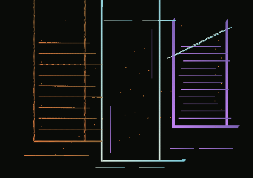

# Registry of Vacant Rooms — original composition 08

Three architectural frames represent an archive whose central entry cannot be reconciled with its neighbours. The left chamber is divided into close ochre ledgers, the middle chamber holds a large deliberate vacancy, and the right register is scoured by short violet shear lines. Isolated thresholds and punched brass marks form an incomplete index. The missing edges are not a rendering defect: the work refuses to turn its separate rooms into one continuous building.

Independent authored composition (no mutation parent, no borrowed image, no external assets). The locally authored `author.mjs` creates its emitter routes and ordered field definitions, four material families, five custom LUTs including dust-radius logic, and sixteen explicit interventions. This aims at solid rectilinear density and deliberately different horizontal/vertical scales rather than another compass, seedhead, kite, stair flight, rain curtain or geological band.

- Seed: `0x6da27f19`, versioned recipe `fw-recipe-v1`, engine `fw-agents-v1`.
- Target tick **162**; independent intermediate replay check **66**.
- Export crop **432×304**, centre **(157,125)**, scale **0.76 world units/pixel**.
- Interventions turn on local vortices, direction quantization and a central attractor; freeze/release the score; and add small late bursts.
- Only genuine FW-012 CPU raster images may be described as canonical. A source description or WebGL preview is not output evidence.

## Regenerate and verify

From repo root with Node 22/24: `npm ci && npm run verify`.
Run `node gallery/originals/08-registry-of-vacant-rooms/qualify.mjs --archived` to assert exact independent raster/recipe provenance replay, or `--write` to re-create all four archived outputs after reviewed changes.
Load `recipe.json` with the local workbench's **Load recipe**, and use **Canonical export** with the tick and crop listed above. The stored PNG/provenance must equal newly exported canonical identities.

The originality and human aesthetic acceptance decision belongs to Integration/owner. No shared source, historical artwork, editor or catalog is changed.

## Actual FW-012 canonical artwork (Node 22/24)



The image above is the **actual** software-raster image regenerated by the approved repository export code in [Windows-independent Ubuntu Node 22/24 CI](https://github.com/techrote/FIELDWEAVER/actions/runs/42971313552) at the exact source commit `9b22c4739f2e984e91903d876665b35a64dd07ed`, not a simulated preview. Both CI executions had passing native Node tests; the two independent Node 22 runs provided complete matching unmodified base64 source chunks for lossless PNG and provenance archival. Git blob bytes are tested against fresh canonical export at the new exact head.

Direct inspection of the canonical 432×304 pixels finds a narrow ochre left-hand chamber with ruled horizontal partitions; a taller icy-pale central aperture with little interior material; a violet eastern chamber cut by short, increasingly displaced registers; and several detached threshold strokes below. The split structure reads as three independently recorded absences, not a landscape. The image's substantial black margin and technical thinness are artistic constraints, not an assertion of universal quality.

| Verified identity | Value |
|---|---|
| Recipe FNV-1a-64 | `3a2c43dd7f49d9aa` |
| Canonical decoded RGBA8 | `56286fc4c1a47bb8` |
| State | `6570a3a9701a96ee` |
| Deposition | `049bdf31300411f8` |
| Result | `ededfccadff3acae` |
| Emitters / depositions | 118 / 11,059 |
| Non-background raster pixels | 8,452 |
| Canonical frame | 162 (432×304) |

Every `npm run verify` now regenerates and checks the committed normalized `recipe.json`, `the-vacant-rooms.png`, complete `fw-export-provenance-v1` JSON and independent `qualification.json`; alternate tile sizes and early replay are checked separately. The content is still a **Draft original** until independent Integration acceptance and physical browser loading.

## Offline owner/Integration review — proposed, not accepted

**One-command review (Node 22/24, from this Draft PR checkout):**

```sh
node gallery/originals/08-registry-of-vacant-rooms/review.mjs
```

The artwork-local launcher uses the **existing** provenance-gated offline review builder. It prints a local `file://` URL: open it in Firefox to see accepted Operator Atlas and Timeline Pulse alongside the visibly labelled **UNMERGED CANDIDATE** Rooms, then choose **Save recipe** on Rooms and load that JSON with the workbench's **Load recipe** command. It creates a fresh temporary HTML rather than overwriting previous evaluations. The test now checks the downloaded recipe's exact normalized contents against the archived author's recipe as well as the visible PNG's original encoded bytes. Native browser import/export and artistic admission remain owner/Integration gates, not claims made by this script.

From a checkout of this **Draft PR branch**, with Node 22 or 24:

```sh
npm ci
npm run verify
node gallery/originals/08-registry-of-vacant-rooms/qualify.mjs --archived
node scripts/review-gallery.mjs --out rooms-review.html --preset operator-atlas --preset timeline-pulse --provenance gallery/originals/08-registry-of-vacant-rooms/the-vacant-rooms.provenance.json
```

Open `rooms-review.html` directly in Firefox. The existing repository tool creates one offline, keyboard-navigable review with two **ACCEPTED PRESET** CPU proofs and this **UNMERGED CANDIDATE**, including recipe, canonical PNG and provenance downloads. It independently replays and checks the candidate's twenty canonical provenance fields and decoded pixels against the archived PNG before producing the page. This does not enroll the artwork into the accepted catalog or replace a working editor recipe. The output path is create-only; use another filename if the first review already exists.

### Current accepted-main admission route (after Integration #77)

On **current main** (merge `275d6bf78d30feb368e76d24a30725232a9ba9fe` or later), run `0Review.cmd` on Windows or `0Review.sh` on POSIX. The source-pinned board now shows exactly two **ACCEPTED PRESET** controls (Operator Atlas, Timeline Pulse) and two **UNMERGED CANDIDATE** works: Rooms #57 and Unwound #50. The earlier proposed Manta #61 and Fourth Pause #62 were **closed unmerged**; they are not current admission targets. This main checkout is the simplest curated browse/compare/export experience; the artwork-local `review.mjs` above remains a self-contained three-card source-replay alternative when reviewing this Draft branch.

For actual workbench import, save Rooms' recipe from the board, run `0Play.cmd`, choose **Load recipe**, then request **Canonical export** at tick **162**, crop **432×304**, world centre **(157,125)**, scale Q16 **49807**. Verify raw decoded RGBA8 FNV `56286fc4c1a47bb8`, rather than comparing browser screenshots or PNG compression alone. Browser smoke/CI cannot substitute for physical owner Firefox import and artwork selection.


### Actual native-pixel curatorial examination, 11 November 2026

The archived **432×304 FW-012 CPU PNG** was opened at source size. Its three separated upright geometries have genuinely different subdivisions: ochre tightly spaced horizontal ledger lines, mostly vacant chalk/mint central frame, and a violet eastern frame with a slanted mint intrusion. Bottom detached horizontal strokes preserve the gaps rather than suggesting a continuous floor. The main strength is **large-scale architectural segmentation** and a legible distribution of silence between three unrelated structures. The limitation is that the middle space is almost without interior development, while the right register's small lavender dashes can disappear at reduced display size.

The **actual** competing CPU PNGs were also visually examined: Original 09 *The Last Manta* (`#61`) resolves into long paired cyan wing contours and very small central body, Original 07 *Zero Meridian* (`#54`) is an incomplete pair of circular bearings traversed by a needle, and Original 04 *Pollen Observatory* (`#47`) comprises five isolated warm-toned whorls. Rooms has a distinct rectilinear, vertically grouped silhouette and clearly separated ochre/chalk/violet structures; it is not an image duplicate. Its occupied fraction, 8,452/131,328 (6.44%), exceeds Manta's 4,431/153,600 (2.88%), but **these are different crops, not a perceptual-quality comparison**. Pollen's warm curved clusters and Meridian's circular ring are structurally different, although all four pieces employ very dark negative space and fine strokes.

**Updated curatorial disposition: HOLD FOR FRAMING JUDGEMENT, not auto-admission.** Rooms has a clearer three-register silhouette than the now-withdrawn Manta #61, but the earlier claim that it should lead the queue is not a substitute for comparison against stronger legacy Drafts. Genuine full-size CPU images of Luminous Ledger #37 and Interval Engine #41 show substantially richer gesture/texture, while Rooms relies on severe rectilinear sparsity. Its restrained structure is intentional; whether that restraint is compelling enough belongs to the owner.

#### Source-exact pixel-boundary audit (12 November 2026)

Re-examined the archived Git-blob-identical **432×304 RGBA** PNG (blob `1eba3a0bd4100f79403c9a4022f250ebea34f5e3`), not a thumbnail or WebGL buffer. The background is `(9,11,8,255)`. Exactly **8,452 of 131,328** pixels (6.44%) are non-background; the occupied bounding box is **x=41..408, y=0..286**. **Ten** non-background pixels reach the **top image row** (x 56, 59, 145, 172–175, 271–273), whereas the bottom, left and right outer edges are empty. Thus the upper ochre and chalk uprights are *literally cut by the crop boundary*. This is verified framing evidence, not a claim that the artistic choice is incorrect.

At actual native size the centre remains almost vacant; fine eastern lavender rules are vulnerable to reduced-size displays. Compare at **100% as well as gallery-card size**, and decide whether the top-edge interruptions are deliberate open-ended architecture. **Owner decision: ADMIT as intentional / REVISE FRAMING on a separately versioned candidate / REJECT.** Do not silently change the immutable canonical image or its hashes. No physical Firefox acceptance is claimed.
